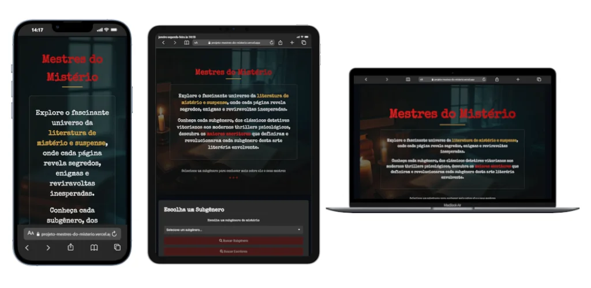

# <span style="color: #FFD700;">**Mestres do Mistério**</span>

Um explorador interativo para descobrir os autores e as características dos subgêneros da literatura de mistério e suspense, utilizando o poder da IA generativa do Google.

[](https://projeto-mestres-do-misterio.vercel.app/)
Para abrir o link em uma nova aba, utilize **Ctrl + Clique** (Windows) ou **Cmd + Clique** (Mac).


## Sobre o Projeto

"Mestres do Mistério" é uma aplicação web de página única (SPA) projetada para amantes da literatura de mistério. A aplicação permite que os usuários explorem o universo do mistério de duas formas distintas: descobrindo os autores mais influentes de um subgênero ou obtendo uma análise aprofundada sobre o próprio subgênero.

Para isso, a aplicação consome uma API backend construída em Node.js, que centraliza a comunicação com o modelo `gemini-2.5-flash` da Google Generative AI para gerar dinamicamente todo o conteúdo apresentado.

## Funcionalidades Principais

- **Seleção de Subgêneros:** Interface com um menu dropdown para escolher entre diversos subgêneros de mistério, como Clássico, Noir, Nórdico, Psicológico, entre outros.
- **Busca Dupla Funcionalidade:** Após selecionar um subgênero, o usuário pode escolher entre:
  1.  **Buscar Escritores:** Retorna uma lista de 15 autores proeminentes, apresentados em cartões interativos.
  2.  **Buscar Subgênero:** Retorna uma descrição detalhada sobre as origens, características, temas e obras seminais do subgênero escolhido.
- **Exibição Detalhada e Interativa:**
  - **Cartões de Autor:** Cada autor é exibido em um cartão com nome, período de vida, descrição de seu estilo e uma lista de suas principais obras. Os detalhes são expansíveis.
  - **Cartão de Descrição:** A análise do subgênero é apresentada em um cartão de largura total, formatado para facilitar a leitura.
- **Experiência de Usuário Refinada:**
  - A interface informa visualmente quando uma busca está em andamento ("Investigação em andamento...").
  - A aplicação se reinicia para um novo estado de busca após cada consulta, melhorando o fluxo de uso.
- **Design Responsivo:** O layout se adapta a diferentes tamanhos de tela.

## Tecnologias e Métodos

O projeto é dividido em duas partes principais: o frontend (cliente) e o backend (servidor).

**Frontend:**
- **HTML5:** Estrutura semântica da aplicação.
- **CSS3:** Estilização e design responsivo, com animações sutis.
- **JavaScript (ES6+):** Manipulação do DOM, interatividade, `async/await` para chamadas de API e gerenciamento de estado da UI.

**Backend:**
- **Node.js:** Ambiente de execução para o servidor.
- **Express.js:** Framework para a criação da API.
- **Google Generative AI SDK (`@google/generative-ai`):** Cliente para interação com a API do Gemini (`gemini-2.5-flash`).
- **`cors`:** Middleware para habilitar o Cross-Origin Resource Sharing.
- **`dotenv`:** Para gerenciamento de variáveis de ambiente (como a chave da API).
- **`nodemon`:** Utilizado em ambiente de desenvolvimento para reiniciar o servidor automaticamente.

### Arquitetura da API

A API foi refatorada para usar um único endpoint `POST /api/search`, que aceita um corpo de requisição com o `subgenre` e o `searchType` ('escritores' ou 'subgenero'). Essa abordagem centraliza a lógica e torna o backend mais escalável para futuras funcionalidades.

**Proteções da API:**
- **Validação do subgênero:** o servidor só aceita os `id` listados no `data.json`. Qualquer outro valor é recusado com erro 400, o que impede que um texto qualquer chegue ao prompt enviado ao Gemini.
- **Limite de requisições:** no máximo 10 buscas por minuto por IP (`express-rate-limit`), para proteger a chave da API e a cota do Gemini.

**Resiliência:** quando o Gemini falha, está sobrecarregado ou devolve uma resposta inválida, o servidor faz até 3 tentativas, com espera crescente entre elas (2 s e 4 s). As duas primeiras usam o modelo principal (`gemini-2.5-flash`) e a terceira usa o modelo de reserva (`gemini-3.5-flash-lite`).

## Como Executar

Para executar este projeto localmente, siga os passos abaixo.

**Pré-requisitos:**
- **Node.js 22.x** instalado (que inclui o `npm`). É a versão declarada no `package.json` e usada no deploy da Vercel.
- Uma **chave de API do Google Gemini**. Você pode obter uma no [Google AI Studio](https://aistudio.google.com/).

**Instalação e Execução:**

1.  **Clone o repositório** (ou baixe e extraia os arquivos do projeto).

2.  **Navegue até a pasta do projeto** pelo seu terminal.

3.  **Crie o arquivo de ambiente:**
    Crie um arquivo chamado `.env` na raiz do projeto e adicione sua chave da API do Gemini:
    ```
    GEMINI_API_KEY=SUA_CHAVE_DE_API_AQUI
    ```

4.  **Instale as dependências do backend:**
    ```bash
    npm install
    ```

5.  **Inicie o servidor backend:**
    ```bash
    npm start
    ```
    O servidor estará rodando em `http://localhost:3000`.

6.  **Abra a aplicação no navegador:**
    Acesse `http://localhost:3000`. O servidor entrega o front-end e a API juntos. Abrir o `index.html` diretamente do disco (endereço `file://`) não funciona, porque as chamadas à API (`/api/search`) são relativas ao endereço do servidor.

Agora você pode selecionar um subgênero e começar a investigar!

## Deploy

O projeto está publicado na Vercel: https://projeto-mestres-do-misterio.vercel.app/

- A cada `git push` na branch `main`, a Vercel faz um novo deploy automaticamente.
- A chave do Gemini fica na variável de ambiente `GEMINI_API_KEY`, configurada no painel do projeto na Vercel. O arquivo `.env` é usado apenas localmente e não é enviado ao GitHub.
- O arquivo `vercel.json` define como o servidor (`api/server.js`) e os arquivos estáticos são publicados.